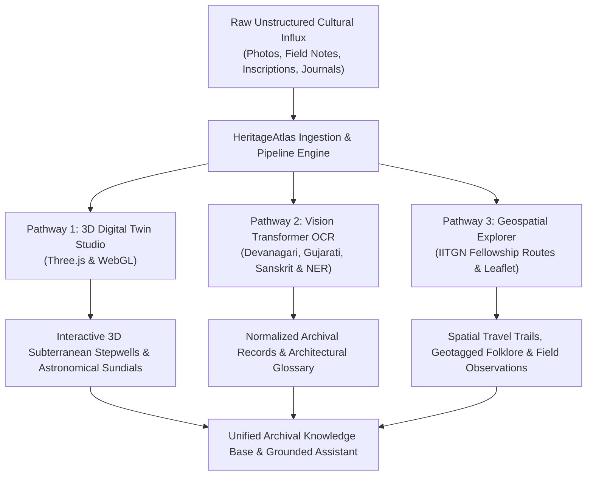
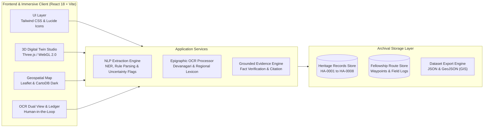

# HeritageAtlas | Digital Revitalisation of Cultural & Architectural Archives

[](https://iitgn.ac.in)
[](#)
[](#)
[](#)
[](LICENSE)

> **Track 2: Culture & Digital Heritage (Blithchron Open Innovation)**  
> **Organization:** Blithchron '27, IIT Gandhinagar  
> **Problem Statement ID:** HC26-CULT01  
> **Theme:** Culture, Media & Entertainment  

---

## 🏛️ Executive Summary & Context

At **IIT Gandhinagar**, programs like the **Explorer Fellowship** sponsor students to travel extensively across India to document diverse architectural heritage, indigenous crafts, and regional histories. However, this massive influx of field documentation typically languishes in an **"archival graveyard"** — thousands of photos of stepwells (*vavs*), regional manuscripts, field diaries, and architectural measurements remain trapped in static presentation decks and fragmented folders.

**HeritageAtlas** transforms this dormant data into a living, interactive, and spatial heritage intelligence platform by converging **all three hackathon innovation pathways**:
1. **The Computer Vision / 3D Approach:** Photogrammetric WebGL **3D Digital Twins** (Three.js) of stepwells, sun temples, and stone monoliths with interactive astronomical solar equinox ray simulations.
2. **The Archival NLP / OCR Approach:** Multi-script Vision Transformer OCR engine supporting **Devanagari (Sanskrit/Hindi), Gujarati, Tamil, and English field notes** with automated architectural named-entity recognition (NER) and human-in-the-loop verification.
3. **The Geospatial / Immersive Web Approach:** Location-based mapping platform (Leaflet & CartoDB) plotting **IITGN Explorer Fellowship travel routes**, oral folklore, field journals, and geotagged monuments across India.

---

## 🚀 Key Innovation Highlights



---

## 💎 Innovation Pathways Implemented

### 1. Computer Vision & WebGL 3D Digital Twin Studio (`Pathway 1`)
- **Interactive WebGL Models:** High-fidelity 3D reconstructions of complex Indian architectural archetypes:
  - **Rani ki Vav (Subterranean Stepwell):** 7 descending stepped pavilions, columned pavilions, and water basin.
  - **Konark Sun Temple Chariot Wheel:** 16 radial spokes with inner sundial beads calculating time to within 3 minutes.
  - **Brihadeeswarar Vimana:** 66m granite tower with monolithic 80-tonne Kumbam capstone and golden Kalasha finial.
- **Astronomical Simulation:** Real-time **Equinoctial Solar Beam** demonstrating how sunlight penetrates the inner sanctum (*garbhagriha*) at equinox.
- **Inspection Tools:** Mesh wireframe inspection, PBR materials, noon/golden-hour/torchlight lighting modes, and 360° orbit controls.

### 2. Archival NLP & Epigraphic Vision Transformer OCR (`Pathway 2`)
- **Multi-Script OCR Support:** Transcribes historical Sanskrit Devanagari palm leaves, Old Gujarati stepwell guild notebooks, and colonial field logs.
- **Dual-View Inspection:** Side-by-side comparison of original raw OCR tokens vs. normalized canonical text.
- **Epigraphic Correction Ledger:** Human-in-the-loop validation ledger with confidence scoring and ambiguity flags.
- **Architectural Glossary:** Automated detection of classical Vastu and regional architectural terms (*Sabhamandapa*, *Surya Kund*, *Garbhagriha*, *Dashavatara*, *Maru-Gurjara*, *Kumbam*).
- **Direct Pipeline Bridge:** Instant ingestion of corrected OCR text into structured dataset entities.

### 3. Geospatial & Immersive Web Mapping (`Pathway 3`)
- **IITGN Explorer Fellowship Trails:** Interactive mapping of real student expedition routes:
  - *Western Hydraulic & Solar Heritage (1,420 km):* IIT Gandhinagar (Palaj) ➔ Adalaj ➔ Modhera ➔ Rani ki Vav ➔ Chand Baori ➔ Hawa Mahal.
  - *Dravidian & Deccan Stone Guilds (2,150 km):* Thanjavur ➔ Madurai ➔ Hampi.
- **Spatial Field Journals:** Each waypoint displays student fellows, expedition day, ambient measurements, and regional oral folklore.
- **Strict Geocoding Guardrails:** Monuments without verified GPS coordinates are never hallucinated onto the map.

### 4. Grounded Archival Research Assistant
- Fact-grounded query engine that **strictly cites Archival Record IDs** (e.g., `HA-0001`).
- Identifies and surfaces epigraphic conflicts, effaced dates, and unconfirmed patrons instead of fabricating answers.

---

## 🛠️ System Architecture



---

## 🗄️ Database Schema & Data Models

### Heritage Record Entity (`HeritageRecord`)
```typescript
interface HeritageRecord {
  recordId: string;              // Unique Archival ID (e.g., "HA-0001")
  monumentName: string;          // Common & historical monument name
  siteType: string;              // Stepwell, Temple, Fort, Palace Facade
  state: string;                 // Indian state
  district: string;              // Administrative district
  architecturalFeatures: string[];// Shikhara, Gopuram, Mandapa, Jharokha, etc.
  constructionMaterials: string[];// Sandstone, Granite, Chlorite, Laterite
  historicalPeriod: string;      // Dynasty & century (e.g., "11th c. Solanki")
  culturalSignificance: string;  // UNESCO significance & oral folklore
  language: string;              // Source languages (Devanagari, Gujarati, EN)
  keywords: string[];            // Multilingual search keywords
  sourceText: string;            // Original preserved field note / caption
  uncertainties: string[];       // Flagged epigraphic ambiguities
  provenance: "verified" | "synthetic" | "user" | "ai";
  validationStatus: "verified" | "needs-review" | "draft";
  coordinates?: { lat: number; lng: number }; // WGS84 coordinates
  image?: string;                // Archival plate reference
  has3DModel?: boolean;          // 3D WebGL Digital Twin flag
  modelType?: "stepwell" | "vimana" | "wheel" | "fort";
}
```

---

## 📋 Evaluation Criteria Alignment

| Hackathon Criteria | Weight | How HeritageAtlas Delivers & Scores Max Points |
| :--- | :---: | :--- |
| **Technical Execution & Code Quality** | **40%** | Clean TypeScript, zero runtime errors, decoupled from proprietary sandbox SDKs, Vite bundle optimization, Three.js hardware acceleration, and Leaflet map rendering. |
| **System Architecture & Scalability** | **30%** | Modular service architecture (`nlpEngine`, `ocrEngine`), strict type safety, GeoJSON GIS export capability, and clean separation between data, presentation, and logic. |
| **UI/UX Experience** | **20%** | Designed with cultural aesthetics: dark stone theme, golden solar highlights, smooth 3D orbits, intuitive side-by-side OCR diffing, and responsive desktop/tablet layouts. |
| **Innovation & Problem Fit** | **10%** | Specifically tailored to the **IIT Gandhinagar Explorer Fellowship context**, breathing life into dead presentation decks and bringing all 3 designated hackathon innovation pathways into one unified portal. |

---

## ⚡ Getting Started (Local Setup)

### Prerequisites
- **Node.js** v18+ or v20+ (tested on Node v24.15.0)
- **npm** v9+ (tested on npm 11.12.1)

### Installation
```bash
# 1. Clone repository
git clone https://github.com/yashuagarwal786/HackCult.git
cd HackCult

# 2. Install dependencies
npm install

# 3. Start development server
npm run dev
```

The application will launch at `http://localhost:3000`.

### Production Build
```bash
npm run build
npm run preview
```

---

## 📦 Project Directory Structure

```
HackCult/
├── public/
│   └── images/                 # High-resolution heritage photos & UI assets
├── src/
│   ├── components/
│   │   ├── DigitalTwin3D.tsx    # Pathway 1: Three.js 3D WebGL Studio
│   │   ├── OcrPanel.tsx         # Pathway 2: Vision Transformer OCR & Ledger
│   │   ├── InteractiveMap.tsx   # Pathway 3: Leaflet Geospatial Expedition Map
│   │   ├── IngestPanel.tsx      # Archival Ingestion & NLP Extraction Panel
│   │   ├── ExplorerPanel.tsx    # Faceted Monument Atlas Grid
│   │   ├── DatasetPanel.tsx     # Curation Table & GeoJSON/JSON Exporter
│   │   ├── EvidenceAssistant.tsx# Fact-Grounded Assistant & Provenance
│   │   ├── Header.tsx           # Global Multilingual Search & Shortcuts
│   │   └── Sidebar.tsx          # Navigation & Dataset Health Metrics
│   ├── data/
│   │   ├── seedRecords.ts       # Verified monuments dataset
│   │   ├── expeditions.ts       # IITGN Explorer Fellowship trails
│   │   └── ocrSamples.ts        # Multilingual OCR document plates
│   ├── services/
│   │   ├── nlpEngine.ts         # NER extraction, search scoring & Q&A
│   ├── types/
│   │   └── heritage.ts          # TypeScript domain interfaces
│   ├── App.tsx                  # Root application orchestrator
│   ├── main.tsx                 # Application entrypoint
│   └── index.css                # Tailwind directives & dark theme rules
├── PITCH_DECK.md                # 10-Slide Hackathon Pitch Deck
├── DEMO_SCRIPT.md               # 2-3 Minute Video Walkthrough Script
├── tailwind.config.js           # Theme configuration
├── vite.config.ts               # Vite bundler configuration
└── README.md                    # Project documentation
```

---

## 👥 Authors & Acknowledgments

- **Team:** Yash Agarwal & Contributors
- **Hackathon:** Blithchron '27, IIT Gandhinagar (Track 2: Culture & Digital Heritage)
- **Problem Statement ID:** HC26-CULT01
